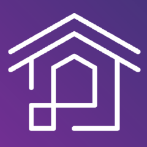

<div align="center">



# Trestle

[](https://github.com/open-lakehouse/trestle/actions/workflows/ci.yml)
[](https://codecov.io/gh/open-lakehouse/trestle)
[](https://crates.io/crates/olai-trestle)
[](LICENSE)

</div>

Trestle generates Rust REST APIs, typed clients, Python (PyO3) and Node.js (NAPI)
bindings, and a graph-based resource store from annotated protobuf. The
`trestle new` command scaffolds a project that uses this pipeline and can deploy
to Databricks Apps.

The pipeline, the crate map, and the design decisions behind it are documented in
[`docs/architecture.md`](docs/architecture.md).

## Crates

| Crate | Description |
|-------|-------------|
| [`olai-trestle`](crates/trestle) | CLI (`trestle` binary): `trestle new` for scaffolding, `trestle generate` and `enrich-openapi` for codegen |
| [`olai-codegen`](crates/olai-codegen) | Proto-driven code generation for REST handlers, clients, resource registries, and language bindings |
| [`olai-store`](crates/olai-store) | Generic, TAO-inspired object and association store with field-role enforcement |
| [`olai-http`](crates/olai-http) | Cloud credential abstraction and HTTP client (AWS, Azure, GCP, Databricks) |
| [`olai-http-wasm`](crates/olai-http-wasm) | Browser/WASM HTTP transport for generated clients |

## Quick start

Install the CLI, then scaffold a project:

```bash
brew install open-lakehouse/tap/trestle   # macOS / Linux, prebuilt binary
# or: cargo binstall olai-trestle          # prebuilt binary via cargo-binstall
# or: cargo install olai-trestle           # build from source

trestle new my-app --app databricks-app-rust
```

The positional argument is the project name. `--app` layers an app template onto
the default `lakehouse` base; `databricks-app-rust` produces a Rust (Axum) service
with proto codegen, an optional React frontend, and CI workflows. Run
`trestle new --help` for every flag, or add `--non-interactive` to accept defaults
without prompts.

The local dev environment (gateway, storage, catalog, ML tracking) is a separate
step, created with `trestle env new`. See the scaffolded project's README for the
next steps.

All three install a binary called `trestle`. The crate is published as
`olai-trestle`.

`trestle list-templates` lists the available bases and apps. See
[`crates/trestle/README.md`](crates/trestle/README.md) for the scaffolding guide and
[`crates/olai-codegen/README.md`](crates/olai-codegen/README.md) for the proto
annotations and codegen config.

To use the libraries directly without scaffolding:

```toml
[dependencies]
olai-store = "0.0"
olai-http = "0.0"

[build-dependencies]
olai-codegen = "0.0"
```

## Prerequisites

- Rust 1.88 or later (edition 2024)
- [buf](https://buf.build/), to compile `.proto` files into a descriptor (codegen only)
- Docker and Docker Compose (optional), for the local platform stack that
  `trestle env` renders

## Build and test

This is a standard Cargo workspace:

```bash
cargo build               # build all crates
cargo test --lib --tests  # unit and integration tests (skips doctests)
```

For the development workflow, linting, and the release process, see
[`CONTRIBUTING.md`](CONTRIBUTING.md).

## License

Apache-2.0. See [LICENSE](LICENSE).
