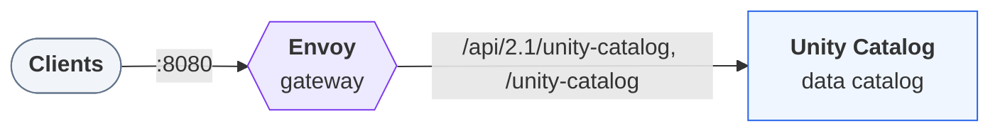

# Deploying `uc-docs`

Generated by `trestle env render`; re-render to update. Follow the steps in order. A step's script
runs from anywhere and is safe to re-run. The services, their routes and addresses are in
[LAYOUT.md](LAYOUT.md).

## Architecture



## Start

### 1. Start the stack

Start every service and wait until each one is healthy:

```bash
docker compose up -d --wait
```

The gateway then serves the stack at <http://localhost:8080>. [LAYOUT.md](LAYOUT.md) lists every route and address.
