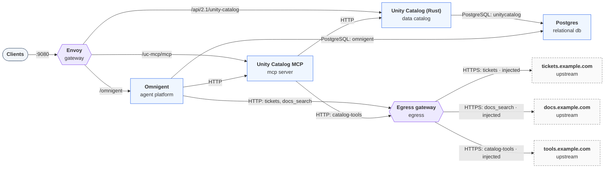

# Deploying `lakehouse`

Generated by `trestle env render`; re-render to update. Follow the steps in order. A step's script
runs from anywhere and is safe to re-run. The services, their routes and addresses are in
[LAYOUT.md](LAYOUT.md).

## Architecture



## Configure

### 1. Give Unity Catalog's key a keyring (`unity-catalog-rs`)

Unity Catalog seals the credentials it stores through the secret server's key service, under
the keyring of its key `server-kek`. The keyring lives in this machine's keychain and reaches
only the secret server: the Unity Catalog container gets the socket and the key's name, never a
key, and nothing of it is written into this directory. Without a keyring the stack doesn't
start.

A new environment gets one with a random first version:

```sh
trestle key rotate <ws>/<env> unity-catalog-rs/server-kek
```

An environment whose server sealed under `UC_SERVER_KEK` before keeps that key as version 1,
under its old id `kek-1`, so what it sealed still opens. `trestle up` imports it once by itself
when `UC_SERVER_KEK` is set (on the environment, its workspace, or in the shell), or:

```sh
trestle key import <ws>/<env> unity-catalog-rs/server-kek --from UC_SERVER_KEK --alias kek-1
```

`trestle key rotate` adds a version while the server runs; `POST /api/admin/v1/encryption/rewrap`
moves what is sealed onto it, `GET /api/admin/v1/encryption/kek-usage` shows what is left, and
`trestle key retire … --below <n> --confirm-swept` stops the old versions opening. The keychain
holds the only copy of the keyring: without it, nothing sealed under it can be read.

### 2. Set the services' own credentials

The services the stack runs use these credentials. Unless `secrets.env` sets them, they are fixed development values, the same in every environment.

| Credential | Name in `secrets.env` |
| --- | --- |
| Postgres superuser password | `LOCAL_POSTGRES_PASSWORD` |

To replace them with random ones, add them to `secrets.env` and render again. Rendering writes each value into every file that uses it (`.env`, `modules/*/.env/`, `modules/*/secrets/`, all git-ignored):

```bash
cat >> secrets.env <<EOF
LOCAL_POSTGRES_PASSWORD=$(openssl rand -hex 32)
EOF
trestle env render .
```

Do this before the first start. Services keep the credentials they first started with in their persisted data (under the data root, `.data/` by default), so a later change also needs that data removed, or the credential changed inside the service.

## Start

### 3. Start the stack

Start every service and wait until each one is healthy:

```bash
docker compose up -d --wait
```

The gateway then serves the stack at <http://localhost:9080>. [LAYOUT.md](LAYOUT.md) lists every route and address.
