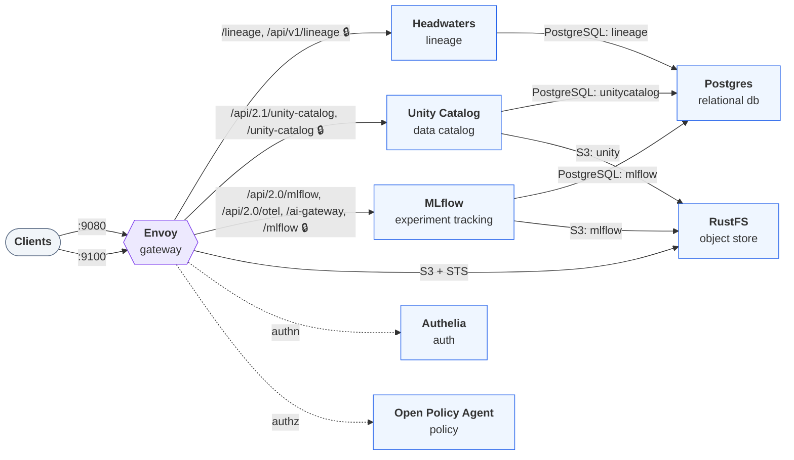

# Deploying `authorized`

Generated by `trestle env render`; re-render to update. Follow the steps in order. A step's script
runs from anywhere and is safe to re-run. The services, their routes and addresses are in
[LAYOUT.md](LAYOUT.md).

## Architecture



## Configure

### 1. Review the sign-in accounts (`authelia`)

Sign-in is on (`[selection.gateway] auth = true`): Authelia checks every API and UI route on the
gateway's shared listener. Browsers get its login page; API clients send basic auth.

The accounts live in `modules/authelia/users.yml`. It starts with one demo account, username
`demo` with password `authelia`. Change or remove that account before you share the
environment. To add, change, or remove users:

1. Edit `modules/authelia/users.yml`. Each user is one block under `users:`. Copy the `demo`
   block, then change the name, `displayname`, `email`, `groups`, and `password`.
2. Hash each password (Authelia stores argon2id hashes, not plain text), then paste the printed
   `$argon2id$…` digest in as the user's `password`:

   ```bash
   docker run --rm authelia/authelia:latest \
     authelia crypto hash generate argon2 --password 'choose-a-password'
   ```
3. If the stack is already running, restart Authelia so it rereads the file:
   `docker compose restart authelia`.

The services behind the gateway receive a user's `email` and `displayname` as the
`Remote-Email` and `Remote-Name` headers, and `groups` as `Remote-Groups`. With policy on, the
default policy lets any signed-in user read and lets the `writers` or `admins` group write.

`trestle env render` writes `users.yml` only when it doesn't exist yet, so your edits survive
re-renders. To start over from the demo account, delete the file and render again.

### 2. Set the services' own credentials

The services the stack runs use these credentials. Unless `secrets.env` sets them, they are fixed development values, the same in every environment.

| Credential | Name in `secrets.env` |
| --- | --- |
| Postgres superuser password | `LOCAL_POSTGRES_PASSWORD` |
| RustFS root access key | `LOCAL_RUSTFS_ACCESS_KEY` |
| RustFS root secret key | `LOCAL_RUSTFS_SECRET_KEY` |
| Authelia session secret | `LOCAL_AUTHELIA_SESSION_SECRET` |
| Authelia storage encryption key | `LOCAL_AUTHELIA_STORAGE_ENCRYPTION_KEY` |
| Authelia identity-verification JWT secret | `LOCAL_AUTHELIA_JWT_SECRET` |

To replace them with random ones, add them to `secrets.env` and render again. Rendering writes each value into every file that uses it (`.env`, `modules/*/.env/`, `modules/*/secrets/`, all git-ignored):

```bash
cat >> secrets.env <<EOF
LOCAL_POSTGRES_PASSWORD=$(openssl rand -hex 32)
LOCAL_RUSTFS_ACCESS_KEY=$(openssl rand -hex 10)
LOCAL_RUSTFS_SECRET_KEY=$(openssl rand -hex 20)
LOCAL_AUTHELIA_SESSION_SECRET=$(openssl rand -hex 32)
LOCAL_AUTHELIA_STORAGE_ENCRYPTION_KEY=$(openssl rand -hex 32)
LOCAL_AUTHELIA_JWT_SECRET=$(openssl rand -hex 32)
EOF
trestle env render .
```

Do this before the first start. Services keep the credentials they first started with in their persisted data (under the data root, `.data/` by default), so a later change also needs that data removed, or the credential changed inside the service.

## Start

### 3. Start the stack

Start every service and wait until each one is healthy:

```bash
docker compose up -d --wait
```

The gateway then serves the stack at <https://authorized.localhost:9080>. [LAYOUT.md](LAYOUT.md) lists every route and address.

## Verify

### 4. Trust the gateway's local certificate authority

The gateway serves HTTPS with a certificate from a CA minted for this environment. Copy it out, then add it to your browser or pass it to `curl --cacert`:

```bash
docker compose cp gateway-certs:/certs/ca.pem .
```
