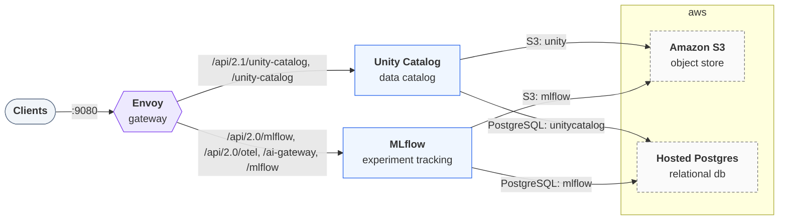

# Deploying `hybrid`

Generated by `trestle env render`; re-render to update. Follow the steps in order. A step's script
runs from anywhere and is safe to re-run. The services, their routes and addresses are in
[LAYOUT.md](LAYOUT.md).

## Architecture



## Provision

### 1. Create the buckets (`aws-s3`)

Create the buckets the stack uses: `unity`, `mlflow`, in `us-east-1`.
The script needs the AWS CLI, signed in with credentials that may create buckets (a profile,
SSO, or keys). Unless `AWS_ACCESS_KEY_ID` is already set, it also
creates the IAM user `trestle-hybrid`, allowed only these buckets, and saves an access key
for it as `AWS_ACCESS_KEY_ID` and `AWS_SECRET_ACCESS_KEY` in
`secrets.env`. The stack's key must also be allowed to assume `arn:aws:iam::123456789012:role/lakehouse-uc`.

```bash
bash deploy/aws-s3-buckets.sh
```

### 2. Create the RDS instance (`hosted-postgres`)

Create an Amazon RDS for PostgreSQL instance. The script needs the AWS CLI, signed in to the
account (a profile, SSO, or keys), and `openssl`. It creates the instance `trestle-hybrid`
unless it exists (in `AWS_REGION`, default `us-east-1`; class `RDS_INSTANCE_CLASS`, default
`db.t4g.micro`), with a generated password unless one is set, waits until it is available, and
saves `PG_PASSWORD` in `secrets.env`.

The instance is publicly accessible in the account's default VPC, so the stack can reach it from
your machine. Allow inbound TCP 5432 from your address in its security group, and nothing wider.

```bash
bash deploy/hosted-postgres-server.sh
```

### 3. Create the databases (`hosted-postgres`)

Create the databases the stack uses: `unitycatalog`, `mlflow`. The script connects with `psql` as the stack's role (it must be allowed to create
databases) and creates each one missing.

```bash
bash deploy/hosted-postgres-databases.sh
```

## Configure

### 4. Supply the hosted resources' secrets

The hosted resources read `AWS_ACCESS_KEY_ID`, `AWS_SECRET_ACCESS_KEY`, `PG_PASSWORD`. Set them in `secrets.env` beside `env.toml` (git-ignored; the scripts above save what they create there) or export them, then render again so the stack picks them up:

```bash
trestle env render .
```

## Start

### 5. Start the stack

Start every service and wait until each one is healthy:

```bash
docker compose up -d --wait
```

The gateway then serves the stack at <http://localhost:9080>. [LAYOUT.md](LAYOUT.md) lists every route and address.
