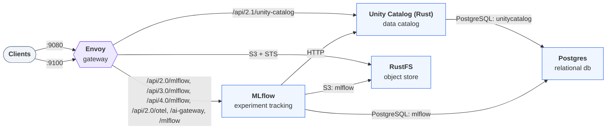

# Deploying `lakehouse-rs`

Generated by `trestle env render`; re-render to update. Follow the steps in order. A step's script
runs from anywhere and is safe to re-run. The services, their routes and addresses are in
[LAYOUT.md](LAYOUT.md).

## Architecture



## Configure

### 1. Set Unity Catalog's key-encryption key (`unity-catalog-rs`)

Unity Catalog seals the credentials it stores with a key-encryption key, read from
`UC_SERVER_KEK` (32 bytes, base64) in the environment of the process that starts the stack.
Compose passes it through to the server; it is never written into this directory, and without
it the server refuses to start. Generate one once and keep it: credentials sealed under it
can't be read with another.

```sh
export UC_SERVER_KEK="$(openssl rand -base64 32)"
```

### 2. Set the services' own credentials

The services the stack runs use these credentials. Unless `secrets.env` sets them, they are fixed development values, the same in every environment.

| Credential | Name in `secrets.env` |
| --- | --- |
| Postgres superuser password | `LOCAL_POSTGRES_PASSWORD` |
| RustFS root access key | `LOCAL_RUSTFS_ACCESS_KEY` |
| RustFS root secret key | `LOCAL_RUSTFS_SECRET_KEY` |

To replace them with random ones, add them to `secrets.env` and render again. Rendering writes each value into every file that uses it (`.env`, `modules/*/.env/`, `modules/*/secrets/`, all git-ignored):

```bash
cat >> secrets.env <<EOF
LOCAL_POSTGRES_PASSWORD=$(openssl rand -hex 32)
LOCAL_RUSTFS_ACCESS_KEY=$(openssl rand -hex 10)
LOCAL_RUSTFS_SECRET_KEY=$(openssl rand -hex 20)
EOF
trestle env render .
```

Do this before the first start. Services keep the credentials they first started with in their persisted data (under the data root, `.data/` by default), so a later change also needs that data removed, or the credential changed inside the service.

## Start

### 3. Start the stack

Start every service and wait until each one is healthy:

```bash
docker compose up -d --wait
```

The gateway then serves the stack at <http://localhost:9080>. [LAYOUT.md](LAYOUT.md) lists every route and address.
