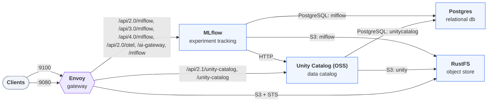

# Deploying `lakehouse`

Generated by `trestle env render`; re-render to update. Follow the steps in order. A step's script
runs from anywhere and is safe to re-run. The services, their routes and addresses are in
[LAYOUT.md](LAYOUT.md).

## Architecture



## Configure

### 1. Set the AI Gateway's key passphrase (`mlflow`)

MLflow seals the provider keys and tokens its AI Gateway stores with a passphrase, read from
`MLFLOW_CRYPTO_KEK_PASSPHRASE` in the environment of the process that starts the stack. Compose
passes it through to the server; it is never written into this directory, and without it the
stack doesn't start. Generate one once and keep it: keys sealed under it can't be read with
another.

```sh
export MLFLOW_CRYPTO_KEK_PASSPHRASE="$(openssl rand -base64 32)"
```

With trestle's state store, keep it in the keychain instead (`<target>` is the workspace or
environment, as for any `trestle var set`):
`openssl rand -base64 32 | trestle var set <target> --secret MLFLOW_CRYPTO_KEK_PASSPHRASE`.

An environment made before the passphrase was required sealed its keys under
`lakehouse-dev-kek`: set that value to keep them, or delete the gateway's secrets in the MLflow
UI and let the next start store them again.

### 2. Set the services' own credentials

The services the stack runs use these credentials. Unless `secrets.env` sets them, they are fixed development values, the same in every environment.

| Credential | Name in `secrets.env` |
| --- | --- |
| Postgres superuser password | `LOCAL_POSTGRES_PASSWORD` |
| RustFS root access key | `LOCAL_RUSTFS_ACCESS_KEY` |
| RustFS root secret key | `LOCAL_RUSTFS_SECRET_KEY` |

To replace them with random ones, add them to `secrets.env` and render again. Rendering writes each value into every file that uses it (`.env`, `modules/*/.env/`, `modules/*/secrets/`, all git-ignored):

```bash
cat >> secrets.env <<EOF
LOCAL_POSTGRES_PASSWORD=$(openssl rand -hex 32)
LOCAL_RUSTFS_ACCESS_KEY=$(openssl rand -hex 10)
LOCAL_RUSTFS_SECRET_KEY=$(openssl rand -hex 20)
EOF
trestle env render .
```

Do this before the first start. Services keep the credentials they first started with in their persisted data (under the data root, `.data/` by default), so a later change also needs that data removed, or the credential changed inside the service.

## Start

### 3. Start the stack

Start every service and wait until each one is healthy:

```bash
docker compose up -d --wait
```

The gateway then serves the stack at <http://localhost:9080>. [LAYOUT.md](LAYOUT.md) lists every route and address.

## Verify

### 4. Find the AI Gateway's traces (`mlflow`)

Each call through the AI Gateway (`/ai-gateway/…` at the gateway, see [LAYOUT.md](LAYOUT.md)) is
recorded as a trace in MLflow. The traces of an endpoint go to its own experiment, named
`gateway/<endpoint>` (e.g. `gateway/claude-opus-5-5`), not to `Default`: open it under
**Experiments**, then **Traces**. The `mlflow-gateway-init` job creates every endpoint with
tracing on, and turns it back on at each start if it was switched off.

The server logs `Failed to send trace to MLflow backend: When an mlflow-artifacts URI was
supplied, …` for each call. That warning is harmless: MLflow has already stored the trace's
spans in its database and only fails to write an extra copy to artifact storage.
