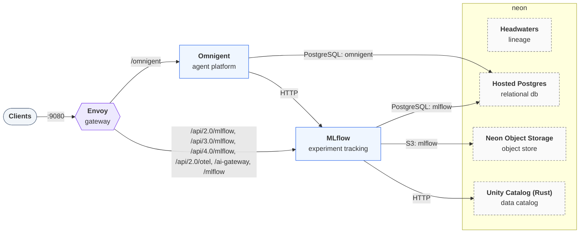

# Deploying `neon-hybrid`

Generated by `trestle env render`; re-render to update. Follow the steps in order. A step's script
runs from anywhere and is safe to re-run. The services, their routes and addresses are in
[LAYOUT.md](LAYOUT.md).

## Architecture



## Provision

### 1. Deploy the function (`headwaters`)

`headwaters` runs as the Neon Function `headwaters` on the Neon branch the environment is
bound to, reached at `https://br-example-123456-headwaters.compute.eu-central-1.aws.neon.tech`; nothing of it runs locally. Deploy it on the branch's parent
(`neon functions deploy`): a branch created from a parent that has the function gets a copy of
it, but a branch that existed before the deploy, or one reset since, needs it deployed again.
`trestle up --neon-branch <branch>` reads the function's URL from the branch and fails when the
function is missing. Function URLs are public: the function must check the caller's Neon Auth
token itself.

### 2. Create the Neon project (`hosted-postgres`)

Create a Neon project for the stack's databases. The script needs
[`neonctl`](https://neon.tech/docs/reference/neon-cli), signed in (`neonctl auth`, or
`NEON_API_KEY` set), and `jq`. It creates the project `trestle-neon-hybrid` unless it exists
(in `NEON_REGION`, default `aws-us-east-2`), then saves its id as `NEON_PROJECT_ID` and its connection details as `PGHOST`, `PGUSER`, `PGPASSWORD` in `secrets.env`.

```bash
bash deploy/hosted-postgres-server.sh
```

### 3. Create the databases (`hosted-postgres`)

Create the databases the stack uses: `mlflow`, `omnigent`. The script adds each one missing to the Neon project
`NEON_PROJECT_ID` with `neonctl`.

```bash
bash deploy/hosted-postgres-databases.sh
```

### 4. Create the buckets (`neon-storage`)

Create the buckets the stack uses: `mlflow`, through the S3-compatible API at `${NEON_S3_ENDPOINT}`.
The script needs the AWS CLI, signed in with credentials that may create buckets (a profile,
SSO, or keys). Set `NEON_S3_ACCESS_KEY_ID` and `NEON_S3_SECRET_ACCESS_KEY` to a
key that may read and write them.

```bash
bash deploy/neon-storage-buckets.sh
```

### 5. Deploy the function (`unity-catalog-rs`)

`unity-catalog-rs` runs as the Neon Function `unitycatalog` on the Neon branch the environment is
bound to, reached at `https://br-example-123456-unitycatalog.compute.eu-central-1.aws.neon.tech`; nothing of it runs locally. Deploy it on the branch's parent
(`neon functions deploy`): a branch created from a parent that has the function gets a copy of
it, but a branch that existed before the deploy, or one reset since, needs it deployed again.
`trestle up --neon-branch <branch>` reads the function's URL from the branch and fails when the
function is missing. Function URLs are public: the function must check the caller's Neon Auth
token itself.

Deploy it with the same configuration it runs with in a container:

`UC_SERVER_CONFIG_YAML`:

```yaml
# What mangrove's Unity Catalog server runs with wherever it runs: this file in a container,
# or `UC_SERVER_CONFIG_YAML` for a Neon Function. API-only, and anonymous until the services
# verify callers' tokens. The key-encryption key is read from `UC_SERVER_KEK` when the server
# starts, so it is never written here. Without it the server refuses to start; there is no
# fallback key.
ui: { serve: false }
auth: { mode: anonymous }
encryption:
  active: { id: kek-1, key: { env: UC_SERVER_KEK } }
```

Set `UC_SERVER_KEK` on the deployment yourself (`neon functions deploy --env`): it holds a secret, so trestle never writes it.

## Configure

### 6. Supply the hosted resources' secrets

The hosted resources read `HEADWATERS_FUNCTION_URL`, `NEON_S3_ACCESS_KEY_ID`, `NEON_S3_ENDPOINT`, `NEON_S3_REGION`, `NEON_S3_SECRET_ACCESS_KEY`, `PGHOST`, `PGPASSWORD`, `PGUSER`, `UNITYCATALOG_FUNCTION_URL`. Set them in `secrets.env` beside `env.toml` (git-ignored; the scripts above save what they create there) or export them, then render again so the stack picks them up:

```bash
trestle env render .
```

## Start

### 7. Start the stack

Start every service and wait until each one is healthy:

```bash
docker compose up -d --wait
```

The gateway then serves the stack at <http://localhost:9080>. [LAYOUT.md](LAYOUT.md) lists every route and address.
